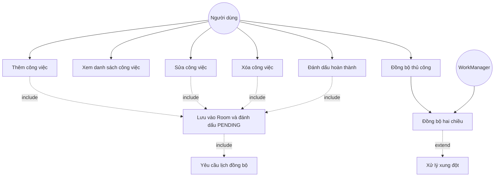
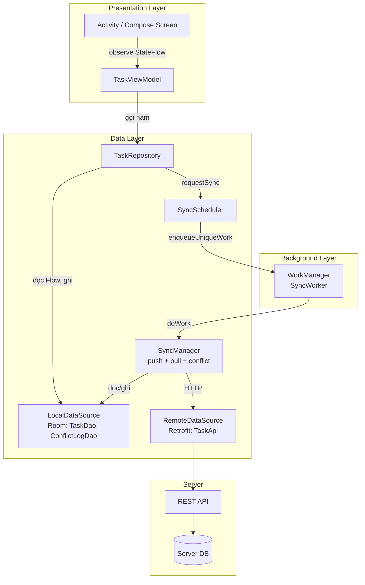
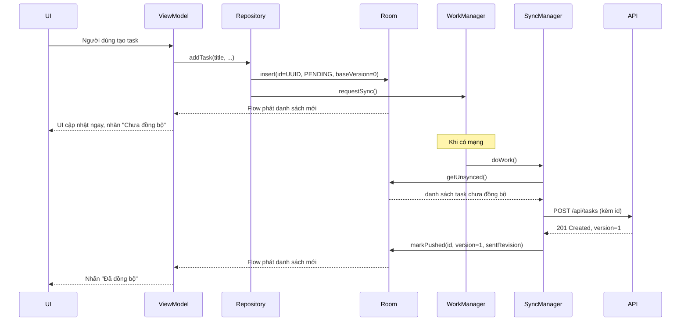
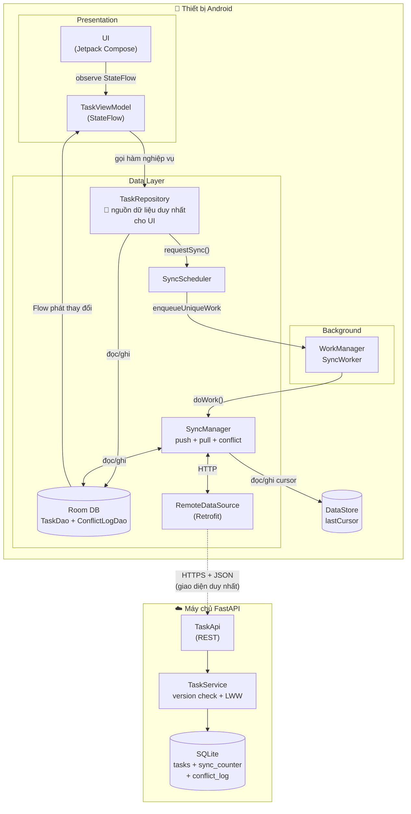
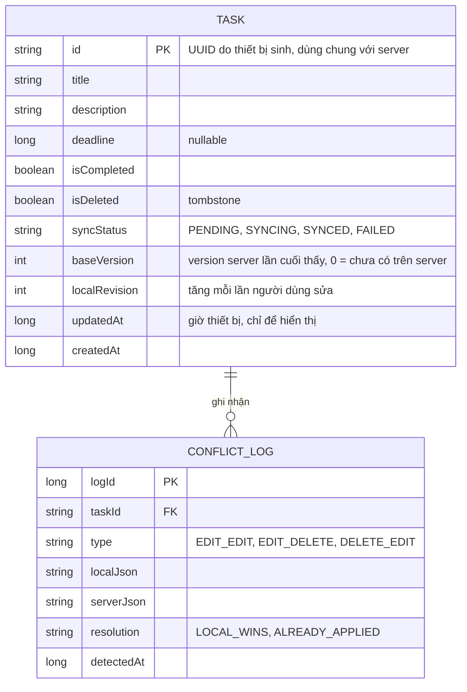
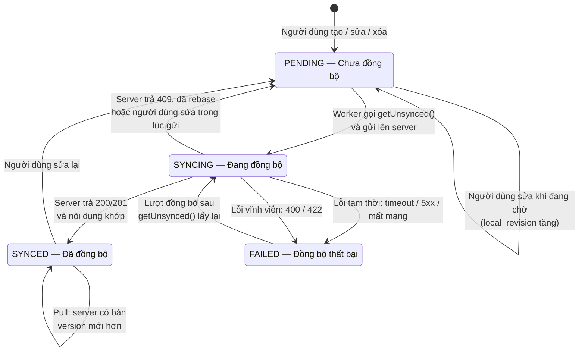
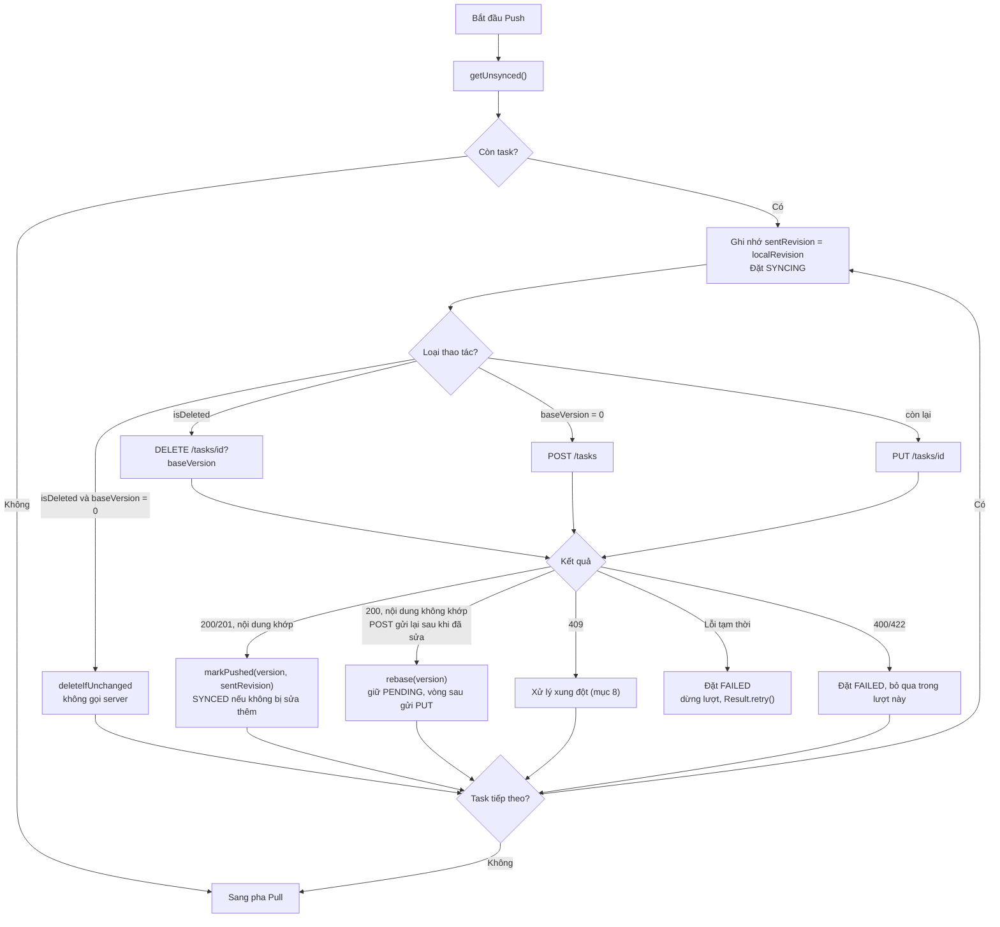
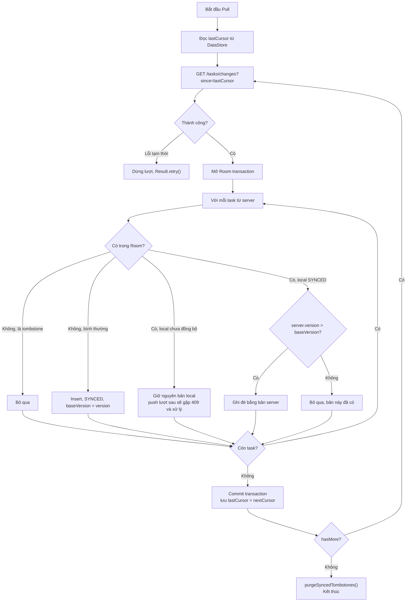
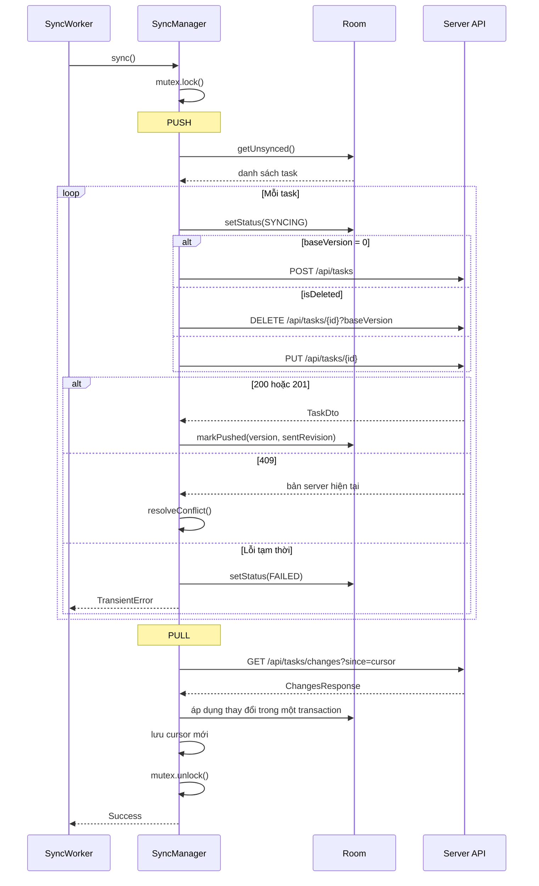
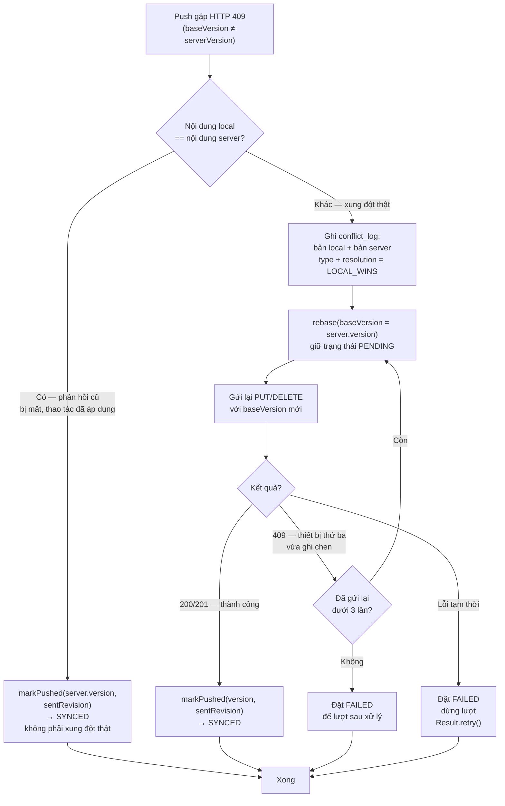

# TÀI LIỆU PHÂN TÍCH VÀ THIẾT KẾ HỆ THỐNG
## Ứng dụng Quản lý Công việc Offline-First

**Sinh viên thực hiện:** MSSV 521H0471
**Cập nhật:** 10/2026

---

## MỤC LỤC
1. [Tổng quan dự án](#1-tổng-quan-dự-án)
2. [Phân tích yêu cầu](#2-phân-tích-yêu-cầu)
3. [Use Cases](#3-use-cases)
4. [Kiến trúc hệ thống](#4-kiến-trúc-hệ-thống)
5. [Thiết kế cơ sở dữ liệu](#5-thiết-kế-cơ-sở-dữ-liệu)
6. [Thiết kế API](#6-thiết-kế-api)
7. [Luồng đồng bộ dữ liệu](#7-luồng-đồng-bộ-dữ-liệu)
8. [Xử lý xung đột và tính lặp an toàn](#8-xử-lý-xung-đột-và-tính-lặp-an-toàn)
9. [Công nghệ sử dụng](#9-công-nghệ-sử-dụng)
10. [Ánh xạ thiết kế với kịch bản kiểm thử](#10-ánh-xạ-thiết-kế-với-kịch-bản-kiểm-thử)

---

## 1. TỔNG QUAN DỰ ÁN

### 1.1. Mục tiêu
Xây dựng ứng dụng Android quản lý công việc cá nhân (Task Management) với khả năng:
- Hoạt động đầy đủ khi không có kết nối mạng
- Tự động đồng bộ hai chiều khi có Internet
- Phát hiện và xử lý xung đột dữ liệu theo một chính sách đã công bố
- Đảm bảo dữ liệu cục bộ và máy chủ hội tụ, không tạo bản ghi trùng

### 1.2. Phạm vi
- **Platform:** Android (API 24+)
- **Language:** Kotlin
- **Architecture:** Offline-First với MVVM + Repository Pattern
- **Core Features:** CRUD công việc, đồng bộ tự động, xử lý xung đột
- **Ngoài phạm vi:** đăng nhập, phân quyền, nhiều người dùng. Toàn bộ thiết bị dùng chung một tập dữ liệu.

### 1.3. Nguyên tắc thiết kế chính
- Room là nguồn dữ liệu duy nhất cho giao diện (Single Source of Truth)
- Mọi thao tác ghi vào Room trước, đồng bộ lên server sau
- Mỗi công việc có một định danh UUID duy nhất do thiết bị sinh ra, dùng chung cho cả thiết bị và server
- Xung đột được phát hiện bằng số phiên bản (`version`) do server quản lý, không dựa vào đồng hồ thiết bị
- Xóa logic (tombstone) để thao tác xóa được đồng bộ như mọi thay đổi khác

---

## 2. PHÂN TÍCH YÊU CẦU

### 2.1. Yêu cầu chức năng

#### UC01: Quản lý công việc cơ bản
- **UC01.1:** Xem danh sách công việc
- **UC01.2:** Thêm công việc mới
- **UC01.3:** Chỉnh sửa công việc
- **UC01.4:** Xóa công việc
- **UC01.5:** Đánh dấu hoàn thành/chưa hoàn thành

#### UC02: Hoạt động ngoại tuyến
- **UC02.1:** Thực hiện mọi thao tác khi không có Internet
- **UC02.2:** Lưu trữ dữ liệu cục bộ bằng Room Database
- **UC02.3:** Hiển thị trạng thái đồng bộ của từng công việc

#### UC03: Đồng bộ dữ liệu
- **UC03.1:** Tự động đồng bộ khi có kết nối mạng
- **UC03.2:** Đẩy thay đổi cục bộ lên server (Push)
- **UC03.3:** Kéo thay đổi từ server xuống (Pull)
- **UC03.4:** Đồng bộ thủ công qua nút bấm
- **UC03.5:** Hiển thị tiến trình và kết quả đồng bộ

#### UC04: Xử lý xung đột
- **UC04.1:** Phát hiện xung đột khi cùng bản ghi được sửa ở nhiều nơi
- **UC04.2:** Áp dụng chính sách Last-Write-Wins theo thứ tự server nhận
- **UC04.3:** Ghi nhật ký xung đột (bản thắng, bản thua) để kiểm tra và khôi phục

#### UC05: Quản lý trạng thái
- **UC05.1:** Hiển thị trạng thái: Chưa đồng bộ, Đang đồng bộ, Đã đồng bộ, Đồng bộ thất bại
- **UC05.2:** Tự động thử lại khi gặp lỗi tạm thời
- **UC05.3:** Hiển thị thông báo lỗi cho người dùng

### 2.2. Yêu cầu phi chức năng

| ID | Yêu cầu | Chỉ số |
|---|---|---|
| **NFR01** | Performance | Thời gian đồng bộ < 5s cho 100 tasks trong mạng LAN |
| **NFR02** | Reliability | Tỷ lệ đồng bộ thành công > 95% khi mạng ổn định |
| **NFR03** | Usability | UI phản hồi thao tác người dùng ngay lập tức (< 100ms), không chờ mạng |
| **NFR04** | Data Consistency | 0 bản ghi trùng, 0 bản ghi lệch sau khi đồng bộ hội tụ |
| **NFR05** | Availability | Toàn bộ chức năng CRUD hoạt động khi offline |
| **NFR06** | Scalability | Hỗ trợ tối thiểu 1000 tasks |
| **NFR07** | Battery Efficiency | Một lượt đồng bộ kết thúc trong vài phút, không chạy liên tục |
| **NFR08** | Security | Server không có xác thực (ngoài phạm vi đề tài), chỉ chạy trong mạng LAN hoặc máy local khi demo, không public ra Internet |

---

## 3. USE CASES

### 3.1. Use Case Diagram



### 3.2. Use Case chi tiết: Thêm công việc khi offline

**Use Case ID:** UC01.2 / UC02.1
**Tên:** Thêm công việc mới khi không có Internet
**Actor:** Người dùng
**Điều kiện tiên quyết:** Ứng dụng đã cài đặt và mở

**Luồng chính:**
1. Người dùng nhấn nút "Thêm công việc"
2. Hệ thống hiển thị form nhập liệu
3. Người dùng nhập tên, mô tả, deadline
4. Người dùng nhấn "Lưu"
5. Hệ thống sinh `id` dạng UUID ngay trên thiết bị
6. Hệ thống lưu vào Room với `syncStatus = PENDING`, `baseVersion = 0` (chưa có trên server), `localRevision = 1`
7. Room phát danh sách mới qua Flow, UI hiển thị công việc ngay lập tức với nhãn "Chưa đồng bộ"
8. Repository gửi yêu cầu đồng bộ cho WorkManager. WorkManager giữ yêu cầu này cho tới khi có mạng, kể cả khi app bị đóng

**Luồng thay thế 8a: Có kết nối Internet**
- 8a1. SyncWorker chạy ngay, đặt công việc sang `SYNCING`
- 8a2. Gửi `POST /api/tasks` kèm `id` do thiết bị sinh
- 8a3. Server trả về công việc với `version = 1`
- 8a4. Nội dung trả về khớp nội dung đã gửi và `localRevision` không đổi, hệ thống đặt `baseVersion = 1`, `syncStatus = SYNCED`

**Luồng thay thế 8a3a: Mất phản hồi**
- Server đã tạo công việc nhưng phản hồi không về tới thiết bị (timeout)
- Worker trả `Result.retry()`, lần sau gửi lại `POST` với cùng `id`
- Server nhận ra `id` đã tồn tại, trả bản hiện có, không tạo bản thứ hai

**Kết quả:** Công việc được lưu cục bộ và chắc chắn được gửi lên server đúng một lần khi có mạng.

---

## 4. KIẾN TRÚC HỆ THỐNG

### 4.1. Tổng quan kiến trúc



Giao diện không bao giờ đọc dữ liệu trực tiếp từ server. Dữ liệu từ server luôn đi vào Room trước, rồi tới UI qua Flow.

### 4.2. Offline-First Flow



### 4.3. Sơ đồ thành phần (UML Component)

Sơ đồ này cho thấy các thành phần lớn của hệ thống, ranh giới trách nhiệm giữa thiết bị và máy chủ, và giao diện giữa hai bên. Đường gạch ngang là giao diện REST API — thứ duy nhất nối thiết bị với máy chủ.



Ba điểm quan trọng thể hiện trong sơ đồ:

- **`TaskRepository` là nguồn dữ liệu duy nhất của UI.** Không có đường đi trực tiếp nào từ `UI` đến máy chủ. Muốn xem dữ liệu thì luôn đọc từ Room.
- **`SyncManager` là nơi duy nhất gọi mạng trong luồng nền.** Nó đọc và ghi cùng một cơ sở dữ liệu Room với `TaskRepository`, nên hai bên không mâu thuẫn về trạng thái.
- **REST API là giao diện duy nhất giữa hai bên.** Chi tiết endpoint xem mục 6.

### 4.4. Vai trò từng thành phần

#### 4.4.1. Presentation Layer
- **Activity/Compose Screen:** hiển thị UI, nhận thao tác người dùng
- **ViewModel:** giữ trạng thái màn hình dưới dạng `StateFlow`, gọi Repository trong `viewModelScope`

#### 4.4.2. Data Layer
- **TaskRepository:** điểm truy cập duy nhất cho ViewModel. Ghi vào Room, sau đó yêu cầu đồng bộ. Không gọi mạng trực tiếp trong luồng thao tác của người dùng
- **LocalDataSource (Room):** lưu trữ bền vững, cung cấp Flow
- **RemoteDataSource (Retrofit):** gọi REST API, phân loại lỗi tạm thời và lỗi vĩnh viễn
- **SyncManager:** thuật toán đồng bộ hai chiều và xử lý xung đột. Dùng một `Mutex` toàn tiến trình để hai worker (một lần và định kỳ) không đồng bộ cùng lúc
- **SyncScheduler:** đăng ký công việc với WorkManager

#### 4.4.3. Background Layer
- **WorkManager:** lập lịch, giữ yêu cầu qua lần đóng app và khởi động lại máy
- **SyncWorker:** gọi `SyncManager.sync()` và chuyển kết quả thành `success`, `retry` hoặc `failure`

### 4.5. Thiết kế giao diện (UI Mockup)

Giao diện gồm 4 màn hình: (1) danh sách task với chip trạng thái đồng bộ, (2) form thêm/sửa dạng bottom sheet, (3) danh sách ở chế độ ngoại tuyến (banner "Bạn đang ở chế độ ngoại tuyến"), (4) banner thông báo xung đột khi LWW tự giải quyết. Ảnh mockup các màn nằm ở [docs/mockups/](docs/mockups/).

Ba quyết định thiết kế cần nêu rõ:
1. **Chip trạng thái đồng bộ** là yếu tố trung tâm của màn danh sách — mỗi task luôn hiển thị một trong bốn trạng thái `PENDING` / `SYNCING` / `SYNCED` / `FAILED` (yêu cầu 1, UC05.1). Trạng thái `FAILED` là chip duy nhất kèm nút "Thử lại".
2. **Offline không chặn thao tác.** Khi mất mạng, app chỉ hiện banner thông báo; mọi thao tác vẫn ghi vào Room như bình thường, task chuyển sang `PENDING`. UI không có luồng "offline nên làm khác".
3. **Mâu thuẫn được xử lý im lặng.** Khi LWW tự rebase thành công, app chỉ hiện banner "⚖️ Đã có thay đổi từ thiết bị khác..." trong vài giây; không có dialog bắt buộc người dùng chọn (chính sách ở mục 8.2, D5).

---

## 5. THIẾT KẾ CƠ SỞ DỮ LIỆU

### 5.1. Room Database Schema



Ý nghĩa ba cột phục vụ đồng bộ:
- `baseVersion`: phiên bản server mà thiết bị đã thấy lần cuối. Gửi kèm khi sửa để server phát hiện xung đột. Chỉ server được tăng version, thiết bị không tự tăng.
- `localRevision`: bộ đếm cục bộ, tăng mỗi lần người dùng sửa. Dùng để biết bản ghi có bị sửa trong lúc đang gửi hay không.
- `updatedAt`: giờ thiết bị, chỉ dùng để hiển thị và sắp xếp, không dùng để quyết định thắng thua khi xung đột.

Trạng thái đồng bộ lấy từ server (con trỏ `lastCursor`) được lưu trong DataStore.

### 5.1.1. Vòng đời trạng thái đồng bộ (State Diagram)

Mỗi task trong Room mang một trường `syncStatus` phản ánh trạng thái đồng bộ của nó. Bốn trạng thái này là đúng những nhãn hiển thị trên giao diện mà yêu cầu 1 đòi hỏi: "Chưa đồng bộ", "Đang đồng bộ", "Đã đồng bộ", "Đồng bộ thất bại".



Bốn quy tắc quan trọng rút ra từ sơ đồ:

1. **`SYNCING → PENDING` khi người dùng sửa trong lúc đang gửi.** Đây là bẫy kinh điển: nếu đặt thẳng `SYNCED` khi server trả 200, thay đổi của người dùng trong lúc chờ sẽ bị bỏ sót vĩnh viễn. Điều kiện `local_revision = sentRevision` trong `markPushed` chính là để chặn trường hợp này.
2. **`FAILED → SYNCING` chứ không phải `→ PENDING`.** Task lỗi vẫn nằm trong tập `sync_status != 'SYNCED'` nên `getUnsynced()` sẽ lấy lại ở lượt kế tiếp. Một số bản ghi lỗi vĩnh viễn bị bỏ qua trong lượt đó, nhưng vẫn được thử lại ở lượt sau — cùng cơ chế với lỗi tạm thời.
3. **Không có đường đi trực tiếp từ `SYNCED` về `SYNCING`.** Muốn đồng bộ lại thì phải quay về `PENDING` trước — đó là lý do mọi thao tác sửa của người dùng đều ghi `sync_status = 'PENDING'`.
4. **`SYNCED → SYNCED` là bước pull.** Khi server có bản mới hơn, bản local được ghi đè nhưng trạng thái vẫn là `SYNCED`, vì dữ liệu đã hội tụ với server.

### 5.2. Entity (Room)

```kotlin
@Entity(tableName = "tasks")
data class TaskEntity(
    @PrimaryKey
    val id: String,

    val title: String,
    val description: String,
    val deadline: Long?,

    @ColumnInfo(name = "is_completed")
    val isCompleted: Boolean = false,

    @ColumnInfo(name = "is_deleted")
    val isDeleted: Boolean = false,

    @ColumnInfo(name = "sync_status")
    val syncStatus: SyncStatus = SyncStatus.PENDING,

    @ColumnInfo(name = "base_version")
    val baseVersion: Int = 0,

    @ColumnInfo(name = "local_revision")
    val localRevision: Int = 1,

    @ColumnInfo(name = "updated_at")
    val updatedAt: Long,

    @ColumnInfo(name = "created_at")
    val createdAt: Long
)

enum class SyncStatus {
    PENDING,   // Chưa đồng bộ
    SYNCING,   // Đang đồng bộ
    SYNCED,    // Đã đồng bộ
    FAILED     // Đồng bộ thất bại, sẽ thử lại ở lượt sau
}

@Entity(tableName = "conflict_log")
data class ConflictLogEntity(
    @PrimaryKey(autoGenerate = true)
    val logId: Long = 0,
    val taskId: String,
    val type: String,
    val localJson: String,
    val serverJson: String,
    val resolution: String,
    val detectedAt: Long
)
```

### 5.3. TaskDao

```kotlin
@Dao
interface TaskDao {
    @Query("SELECT * FROM tasks WHERE is_deleted = 0 ORDER BY deadline IS NULL, deadline ASC")
    fun observeTasks(): Flow<List<TaskEntity>>

    @Query("SELECT * FROM tasks WHERE id = :id")
    suspend fun getById(id: String): TaskEntity?

    @Insert(onConflict = OnConflictStrategy.ABORT)
    suspend fun insert(task: TaskEntity)

    @Upsert
    suspend fun upsert(task: TaskEntity)

    // Mọi thao tác sửa của người dùng đi qua đây
    @Query("""
        UPDATE tasks SET title = :title, description = :description, deadline = :deadline,
            is_completed = :isCompleted, sync_status = 'PENDING',
            local_revision = local_revision + 1, updated_at = :now
        WHERE id = :id
    """)
    suspend fun updateContent(
        id: String, title: String, description: String,
        deadline: Long?, isCompleted: Boolean, now: Long
    )

    @Query("""
        UPDATE tasks SET is_deleted = 1, sync_status = 'PENDING',
            local_revision = local_revision + 1, updated_at = :now
        WHERE id = :id
    """)
    suspend fun softDelete(id: String, now: Long)

    // Gồm cả SYNCING: chỉ có một lượt đồng bộ tại một thời điểm,
    // nên SYNCING còn sót lại lúc bắt đầu nghĩa là lượt trước bị ngắt giữa chừng
    @Query("SELECT * FROM tasks WHERE sync_status != 'SYNCED'")
    suspend fun getUnsynced(): List<TaskEntity>

    @Query("UPDATE tasks SET sync_status = :status WHERE id = :id")
    suspend fun setStatus(id: String, status: SyncStatus)

    // Luôn cập nhật base_version theo server, nhưng chỉ đặt SYNCED
    // khi người dùng không sửa thêm kể từ lúc gửi
    @Query("""
        UPDATE tasks SET base_version = :serverVersion,
            sync_status = CASE WHEN local_revision = :sentRevision THEN 'SYNCED' ELSE 'PENDING' END
        WHERE id = :id
    """)
    suspend fun markPushed(id: String, serverVersion: Int, sentRevision: Int)

    // Server đã có version mới hơn nhưng nội dung chưa khớp: giữ PENDING để gửi lại
    @Query("UPDATE tasks SET base_version = :serverVersion, sync_status = 'PENDING' WHERE id = :id")
    suspend fun rebase(id: String, serverVersion: Int)

    // Task tạo rồi xóa khi offline, chưa từng lên server
    @Query("DELETE FROM tasks WHERE id = :id AND local_revision = :sentRevision")
    suspend fun deleteIfUnchanged(id: String, sentRevision: Int)

    @Query("DELETE FROM tasks WHERE is_deleted = 1 AND sync_status = 'SYNCED'")
    suspend fun purgeSyncedTombstones()
}
```

### 5.4. Server Database Schema

```sql
CREATE TABLE tasks (
    id           VARCHAR(36)  PRIMARY KEY,      -- UUID do thiết bị sinh
    title        VARCHAR(255) NOT NULL,
    description  TEXT         NOT NULL DEFAULT '',
    deadline     BIGINT       NULL,
    is_completed BOOLEAN      NOT NULL DEFAULT FALSE,
    is_deleted   BOOLEAN      NOT NULL DEFAULT FALSE,
    version      INT          NOT NULL,         -- server tăng mỗi lần ghi
    change_seq   BIGINT       NOT NULL,         -- con trỏ cho đồng bộ tăng dần
    created_at   BIGINT       NOT NULL,
    updated_at   BIGINT       NOT NULL          -- giờ server
);
CREATE INDEX idx_tasks_change_seq ON tasks (change_seq);

-- Bộ đếm thay đổi toàn cục. Mỗi lần ghi, cập nhật dòng này trong cùng transaction.
-- Khóa trên dòng này buộc các lần ghi commit theo đúng thứ tự change_seq,
-- nên client đọc theo "since" không bỏ sót thay đổi.
CREATE TABLE sync_counter (
    id    INT    PRIMARY KEY,
    value BIGINT NOT NULL
);
INSERT INTO sync_counter (id, value) VALUES (1, 0);
```

Server không bao giờ xóa hẳn bản ghi. Bản ghi bị xóa giữ `is_deleted = TRUE` để các thiết bị khác nhận được thông tin xóa khi pull.

---

## 6. THIẾT KẾ API

### 6.1. API Endpoints

| Method | Endpoint | Mô tả | Response |
|--------|----------|-------|----------|
| GET | `/api/tasks` | Lấy tất cả task chưa xóa | `200` + `List<TaskDto>` |
| GET | `/api/tasks/changes?since={cursor}&limit=100` | Lấy các thay đổi (gồm cả tombstone) có `change_seq > since` | `200` + `ChangesResponse` |
| POST | `/api/tasks` | Tạo task với `id` do client gửi. Lặp an toàn theo `id` | `201` nếu tạo mới, `200` + bản hiện có nếu `id` đã tồn tại |
| PUT | `/api/tasks/{id}` | Cập nhật, kèm `baseVersion` | `200` thành công, `409` + bản server nếu lệch version, `404` nếu không có |
| DELETE | `/api/tasks/{id}?baseVersion={v}` | Xóa logic | `200` + tombstone (cả khi đã xóa trước đó), `409` + bản server nếu lệch version |
| GET | `/api/stats` | Số lượng task, tombstone, version lớn nhất | Dùng đối chiếu tính nhất quán ở TC09 |
| POST | `/api/debug/fault` | Bật lỗi giả lập: `error500`, `delay`, `dropResponse` | Chỉ dùng khi kiểm thử TC05, TC06 |

`DELETE` trả `200` kèm body (thay vì `204`) để client biết `version` mới của tombstone.

### 6.2. Data Models

```kotlin
@Serializable
data class TaskDto(
    val id: String,
    val title: String,
    val description: String,
    val deadline: Long?,
    val isCompleted: Boolean,
    val isDeleted: Boolean,
    val version: Int,       // do server cấp
    val createdAt: Long,
    val updatedAt: Long     // giờ server
)

@Serializable
data class CreateTaskRequest(
    val id: String,
    val title: String,
    val description: String,
    val deadline: Long?,
    val isCompleted: Boolean,
    val createdAt: Long
)

@Serializable
data class UpdateTaskRequest(
    val baseVersion: Int,
    val title: String,
    val description: String,
    val deadline: Long?,
    val isCompleted: Boolean,
    val isDeleted: Boolean  // cho phép khôi phục task đã bị xóa ở nơi khác (xem 8.4)
)

@Serializable
data class ChangesResponse(
    val tasks: List<TaskDto>,
    val nextCursor: Long,   // change_seq lớn nhất trong trang này
    val hasMore: Boolean
)
```

### 6.3. Response khi xung đột

```json
{
    "error": "VERSION_CONFLICT",
    "baseVersion": 3,
    "current": {
        "id": "6f1c2a9e-...",
        "title": "Mua sữa chua",
        "isCompleted": false,
        "isDeleted": false,
        "version": 4,
        "updatedAt": 1792900000000
    }
}
```

### 6.4. Xử lý phía server

Logic được viết bằng SQL để không phụ thuộc framework. Khi chọn framework server (mục 9.2), mỗi endpoint chỉ cần bọc đoạn SQL tương ứng trong một transaction.

**POST /api/tasks: tạo, lặp an toàn**
```sql
-- Trong một transaction
UPDATE sync_counter SET value = value + 1 WHERE id = 1 RETURNING value;   -- :seq
INSERT INTO tasks (id, title, description, deadline, is_completed, is_deleted,
                   version, change_seq, created_at, updated_at)
VALUES (:id, :title, :description, :deadline, :isCompleted, FALSE,
        1, :seq, :createdAt, :serverNow)
ON CONFLICT (id) DO NOTHING;
SELECT * FROM tasks WHERE id = :id;
-- INSERT thêm 1 dòng: 201. Không thêm dòng nào (id đã tồn tại): 200 + bản hiện có
```
Khóa chính `id` cùng `ON CONFLICT DO NOTHING` đảm bảo hai request trùng đến cùng lúc vẫn chỉ tạo một bản ghi. Database chặn trùng, không phụ thuộc thứ tự "kiểm tra rồi mới chèn" trong code.

**PUT /api/tasks/{id}: cập nhật có kiểm tra version**
```sql
-- Trong một transaction
UPDATE sync_counter SET value = value + 1 WHERE id = 1 RETURNING value;   -- :seq
UPDATE tasks
SET title = :title, description = :description, deadline = :deadline,
    is_completed = :isCompleted, is_deleted = :isDeleted,
    version = version + 1, change_seq = :seq, updated_at = :serverNow
WHERE id = :id AND version = :baseVersion
RETURNING *;
-- Có dòng trả về: 200
-- Không có dòng: SELECT theo id. Không tồn tại: 404. Tồn tại: 409 + bản hiện tại
```
Điều kiện `version = :baseVersion` nằm ngay trong câu `UPDATE`, nên kiểm tra và ghi là một bước nguyên tử. Hai thiết bị gửi cùng lúc thì chỉ một bên thành công, bên còn lại nhận `409`.

**DELETE /api/tasks/{id}**: giống PUT nhưng chỉ đặt `is_deleted = TRUE`. Nếu bản ghi đã là tombstone thì trả `200` với bản hiện có mà không ghi gì thêm.

### 6.5. Retrofit Interface (phía Android)

```kotlin
interface TaskApi {
    @GET("api/tasks")
    suspend fun getAll(): List<TaskDto>

    @GET("api/tasks/changes")
    suspend fun getChanges(
        @Query("since") since: Long,
        @Query("limit") limit: Int = 100
    ): ChangesResponse

    @POST("api/tasks")
    suspend fun create(@Body body: CreateTaskRequest): Response<TaskDto>

    @PUT("api/tasks/{id}")
    suspend fun update(@Path("id") id: String, @Body body: UpdateTaskRequest): Response<TaskDto>

    @DELETE("api/tasks/{id}")
    suspend fun delete(@Path("id") id: String, @Query("baseVersion") baseVersion: Int): Response<TaskDto>
}
```

OkHttp đặt `connectTimeout = 10s`, `readTimeout = 15s` để worker không treo khi mạng chập chờn.

### 6.6. Phân loại lỗi

| Tình huống | Loại | Xử lý |
|---|---|---|
| `IOException`, timeout, mất kết nối | Tạm thời | Dừng lượt đồng bộ, `Result.retry()` |
| `5xx`, `429` | Tạm thời | Dừng lượt đồng bộ, `Result.retry()` |
| `409` | Xung đột | Chạy chính sách ở mục 8 |
| `400`, `422` | Vĩnh viễn với task đó | Đặt task `FAILED`, tiếp tục các task khác |
| `404` khi PUT | Server không có bản ghi | Gửi lại bằng `POST` |
| `404` khi DELETE | Server không có bản ghi | Coi như đã xóa |

---

## 7. LUỒNG ĐỒNG BỘ DỮ LIỆU

### 7.1. Two-Way Sync Strategy

Mỗi lượt đồng bộ chạy tuần tự hai pha, bên trong một `Mutex`:
1. **Push:** đẩy mọi bản ghi chưa đồng bộ lên server. Xung đột được phát hiện và xử lý ở pha này.
2. **Pull:** kéo các thay đổi có `change_seq > lastCursor` từ server về.

Push chạy trước để thay đổi của thiết bị lên server sớm nhất, và để pha pull không bao giờ phải ghi đè lên bản ghi chưa gửi.

Push chạy tối đa 3 vòng trong một lượt. Vòng sau chỉ xử lý những bản ghi vừa chuyển về `PENDING` ở vòng trước (do người dùng sửa trong lúc gửi, hoặc do rebase sau xung đột). Bản ghi lỗi vĩnh viễn không được thử lại trong cùng lượt.

### 7.2. Push Flow (Local → Server)



### 7.3. Pull Flow (Server → Local)



Nếu app bị tắt sau khi commit transaction nhưng trước khi lưu `lastCursor`, lần sau sẽ áp dụng lại cùng trang dữ liệu đó. Việc này vô hại vì bước so sánh version bỏ qua các bản đã có.

### 7.4. Sync Sequence Diagram



### 7.5. Push một task (mã giả Kotlin)

```kotlin
private suspend fun pushOne(task: TaskEntity): PushOutcome {
    val sentRevision = task.localRevision

    if (task.isDeleted && task.baseVersion == 0) {
        dao.deleteIfUnchanged(task.id, sentRevision)
        return PushOutcome.Done
    }

    dao.setStatus(task.id, SyncStatus.SYNCING)
    val response = when {
        task.isDeleted -> api.delete(task.id, task.baseVersion)
        task.baseVersion == 0 -> api.create(task.toCreateRequest())
        else -> api.update(task.id, task.toUpdateRequest())
    }

    return when (response.code()) {
        200, 201 -> {
            val server = response.body()!!
            if (server.sameContentAs(task)) {
                dao.markPushed(task.id, server.version, sentRevision)
            } else {
                dao.rebase(task.id, server.version)
            }
            PushOutcome.Done
        }
        409 -> resolveConflict(task, response.conflictBody().current)
        404 -> handleNotFound(task)
        400, 422 -> { dao.setStatus(task.id, SyncStatus.FAILED); PushOutcome.PermanentError }
        else -> { dao.setStatus(task.id, SyncStatus.FAILED); PushOutcome.TransientError }
    }
    // IOException được bắt ở hàm gọi: đặt FAILED và trả TransientError
}
```

### 7.6. WorkManager Configuration

```kotlin
class SyncWorker(
    context: Context,
    params: WorkerParameters,
    private val syncManager: SyncManager   // inject qua HiltWorker
) : CoroutineWorker(context, params) {

    override suspend fun doWork(): Result = when (syncManager.sync()) {
        SyncResult.Success -> Result.success()
        SyncResult.TransientError ->
            if (runAttemptCount < 5) Result.retry() else Result.failure()
        SyncResult.PermanentError -> Result.failure()
    }
}

object SyncScheduler {
    private const val ONE_TIME = "task-sync"
    private const val PERIODIC = "task-sync-periodic"

    private val networkConstraint = Constraints.Builder()
        .setRequiredNetworkType(NetworkType.CONNECTED)
        .build()

    // Gọi sau mỗi thao tác ghi, khi mở app và khi bấm nút "Đồng bộ"
    fun requestSync(context: Context) {
        val request = OneTimeWorkRequestBuilder<SyncWorker>()
            .setConstraints(networkConstraint)
            .setBackoffCriteria(BackoffPolicy.EXPONENTIAL, 30, TimeUnit.SECONDS)
            .build()
        WorkManager.getInstance(context).enqueueUniqueWork(
            ONE_TIME,
            ExistingWorkPolicy.APPEND_OR_REPLACE,
            request
        )
    }

    // Kéo thay đổi từ thiết bị khác về định kỳ
    fun schedulePeriodic(context: Context) {
        val request = PeriodicWorkRequestBuilder<SyncWorker>(15, TimeUnit.MINUTES)
            .setConstraints(networkConstraint)
            .build()
        WorkManager.getInstance(context).enqueueUniquePeriodicWork(
            PERIODIC,
            ExistingPeriodicWorkPolicy.KEEP,
            request
        )
    }
}
```

Lý do chọn cấu hình:
- **`APPEND_OR_REPLACE`:** thay đổi phát sinh trong lúc worker đang chạy được xếp thêm một lượt phía sau, không cắt ngang lượt đang gửi (khác với `REPLACE`) và không bị bỏ qua (khác với `KEEP`). Nếu lượt trước thất bại hẳn, chuỗi hỏng được thay bằng lượt mới. Các lượt xếp sau thường kết thúc rất nhanh vì không còn gì để gửi.
- **Mutex trong `SyncManager`:** worker một lần và worker định kỳ có tên khác nhau nên WorkManager có thể chạy cả hai cùng lúc. Mutex bảo đảm chỉ một lượt đồng bộ chạy tại một thời điểm.
- **Exponential backoff 30s:** lỗi tạm thời được thử lại sau 30s, 60s, 120s... tránh dồn tải lên server đang lỗi.
- **Giới hạn:** WorkManager lưu yêu cầu qua lần đóng app và khởi động lại máy, nhưng thời điểm chạy phụ thuộc hệ điều hành (Doze, chính sách tiết kiệm pin của từng hãng). App gọi `requestSync()` mỗi lần mở để không phụ thuộc hoàn toàn vào lịch của hệ thống.

---

## 8. XỬ LÝ XUNG ĐỘT VÀ TÍNH LẶP AN TOÀN

### 8.1. Khi nào có xung đột

Xung đột xảy ra khi một bản ghi bị sửa độc lập ở hai nơi kể từ phiên bản chung gần nhất. Thiết bị nhận biết qua `409`: nó gửi `baseVersion = 3` nhưng server đã ở `version = 4`, nghĩa là có thiết bị khác ghi chen vào.

Thiết kế không so sánh đồng hồ giữa các thiết bị vì:
- Đồng hồ điện thoại có thể lệch hoặc bị người dùng chỉnh, khiến bản sửa trước "thắng" bản sửa sau
- So hai mốc giờ chỉ cho biết bản nào muộn hơn, không cho biết server có bị sửa kể từ lần cuối thiết bị thấy nó hay không. Version trả lời đúng câu hỏi đó.

### 8.2. Chính sách: Last-Write-Wins theo thứ tự server nhận

Khi push nhận `409`, thiết bị so sánh bản local với bản server hiện tại:
1. **Nội dung giống nhau:** không phải xung đột thật. Đây là lần ghi trước của chính thiết bị đã được áp dụng nhưng phản hồi bị mất. Gọi `markPushed(server.version, sentRevision)`.
2. **Nội dung khác nhau:** ghi `conflict_log` (bản local, bản server), rồi gửi lại thao tác với `baseVersion = server.version`. Thao tác của thiết bị là thao tác đến server sau cùng, nên nó thắng.
3. Nếu lần gửi lại vẫn `409` (thiết bị thứ ba vừa ghi chen), lặp lại tối đa 3 lần, sau đó đặt `FAILED` để lượt sau xử lý.

```kotlin
private suspend fun resolveConflict(local: TaskEntity, server: TaskDto): PushOutcome {
    if (server.sameContentAs(local)) {
        dao.markPushed(local.id, server.version, local.localRevision)
        return PushOutcome.Done
    }
    conflictLogDao.insert(
        ConflictLogEntity(
            taskId = local.id,
            type = conflictType(local, server),
            localJson = json.encodeToString(local.toDto()),
            serverJson = json.encodeToString(server),
            resolution = "LOCAL_WINS",
            detectedAt = System.currentTimeMillis()
        )
    )
    dao.rebase(local.id, server.version)   // vòng push sau gửi lại với baseVersion mới
    return PushOutcome.Rebased
}
```

#### 8.2.1. Thuật toán xử lý xung đột

Sơ đồ dưới đây là thuật toán đầy đủ mà `resolveConflict()` thực hiện, kèm cả vòng lặp gửi lại tối đa 3 lần. Đây là sơ đồ thuật toán dùng để minh họa cho deliverable D5.



Điểm quan trọng nhất của thuật toán nằm ở nhánh bên trái: **trước khi coi là xung đột, thiết bị so nội dung local với nội dung server**. Nếu hai bên giống nhau thì đây không phải xung đột mà là trường hợp phản hồi bị mất trên đường truyền (TC06) — thao tác đó đã được server áp dụng thành công, chỉ là thiết bị chưa nhận được phản hồi. Nếu không có bước kiểm tra này, mỗi lần thử lại sẽ sinh ra một xung đột giả và ghi đè lên dữ liệu đúng.

### 8.3. Lý do chọn chính sách

- **Đơn giản và dễ kiểm chứng:** quy tắc chỉ có một câu, dễ giải thích và dễ tái hiện khi demo TC07.
- **Không phụ thuộc đồng hồ thiết bị:** thứ tự thắng thua do server quyết định.
- **Luôn hội tụ:** sau khi các thiết bị đồng bộ xong, mọi nơi đều có cùng bản cuối cùng mà server nhận.
- **Phù hợp nghiệp vụ:** app quản lý công việc cá nhân, cùng một task hiếm khi bị sửa đồng thời trên hai thiết bị, và hậu quả của việc mất một lần sửa là nhỏ.

### 8.4. Bảng tình huống

| Thiết bị A (đã lên server trước) | Thiết bị B (lên server sau) | Kết quả |
|---|---|---|
| Sửa title | Sửa title | Bản của B thắng. Bản của A lưu trong `conflict_log` của B |
| Sửa title | Đánh dấu hoàn thành | Bản của B thắng toàn bộ, nên thay đổi title của A bị mất |
| Sửa | Xóa | Xóa thắng, task biến mất ở mọi thiết bị |
| Xóa | Sửa | Sửa thắng, B gửi `isDeleted = false` nên task sống lại ở mọi thiết bị |
| Xóa | Xóa | Không phải xung đột, server trả `200` với tombstone |
| Tạo task, phản hồi bị mất | (chính A gửi lại) | Không phải xung đột, server trả bản đã có, không tạo trùng |

### 8.5. Các trường hợp chính sách gây mất dữ liệu

1. **Ghi đè cả bản ghi:** bên thua mất toàn bộ thay đổi, kể cả những trường bên thắng không hề sửa (dòng 2 của bảng trên).
2. **Thiết bị offline lâu thắng:** điện thoại offline 3 ngày sửa task. Hôm qua laptop đã sửa task đó. Khi điện thoại có mạng, bản sửa cũ hơn (theo giờ thực) của nó lại thắng, vì nó đến server sau.
3. **Xóa và sửa phụ thuộc thứ tự đến:** cùng một cặp thao tác cho kết quả ngược nhau tùy bên nào đồng bộ trước.

Giảm thiểu: `conflict_log` giữ lại bản thua để có thể xem và khôi phục. Hướng mở rộng nếu còn thời gian là gộp theo trường (field-level merge): server lưu thêm version cho từng trường, hai bên sửa hai trường khác nhau thì giữ cả hai. Cách này loại bỏ được trường hợp 1.

### 8.6. Tính lặp an toàn (idempotency)

| Thao tác bị gửi lại | Vì sao không gây hậu quả |
|---|---|
| `POST` tạo task | `id` do client sinh là khóa chính trên server. Lần gửi lại trả bản đã có |
| `PUT` cập nhật | Lần đầu đã tăng version nên lần gửi lại nhận `409`. Nội dung trùng khớp nên client chỉ đánh dấu `SYNCED` |
| `DELETE` | Tombstone đã có thì server trả `200` mà không ghi thêm |
| Áp dụng lại một trang pull | So sánh version bỏ qua bản đã có |
| Hai request trùng đến cùng lúc | `ON CONFLICT DO NOTHING` và `UPDATE ... WHERE version = :baseVersion` là thao tác nguyên tử trong database |

Kết hợp với việc chỉ đánh dấu `SYNCED` khi nội dung server khớp nội dung đã gửi và `localRevision` không đổi, hệ thống bảo đảm không tạo trùng và không âm thầm bỏ sót thay đổi nào.

---

## 9. CÔNG NGHỆ SỬ DỤNG

### 9.1. Android Stack

Phiên bản cụ thể sẽ chốt theo bản ổn định mới nhất lúc khởi tạo project.

| Component | Technology | Purpose |
|-----------|-----------|---------|
| Language | Kotlin 2.x | Ngôn ngữ chính |
| UI | Jetpack Compose | Giao diện |
| Architecture | MVVM + Repository | Tách lớp giao diện và dữ liệu |
| DI | Hilt (kèm `hilt-work`) | Dependency injection, inject vào Worker |
| Database | Room | Lưu trữ cục bộ, Flow |
| Preferences | DataStore | Lưu `lastCursor` |
| Networking | Retrofit + OkHttp | REST client, timeout |
| Serialization | kotlinx.serialization | JSON |
| Async | Coroutines + Flow | Bất đồng bộ, theo dõi dữ liệu |
| Background | WorkManager | Đồng bộ nền |

### 9.2. Server Stack (chưa chốt)

**Option 1: Node.js + Express**
- Runtime Node.js LTS, framework Express
- Database: SQLite (đơn giản, ghi tuần tự sẵn) hoặc PostgreSQL

**Option 2: Spring Boot (Kotlin)**
- Cùng ngôn ngữ với app Android
- Database: PostgreSQL, Spring Data JPA hoặc JDBC

Cả hai lựa chọn đều dùng được logic SQL ở mục 6.4.

### 9.3. Development Tools

- **IDE:** Android Studio
- **Version Control:** Git + GitHub
- **API Testing:** Postman / Bruno
- **Database Tool:** App Inspection (Database Inspector) của Android Studio, DBeaver
- **Diagram:** Mermaid

---

## 10. ÁNH XẠ THIẾT KẾ VỚI KỊCH BẢN KIỂM THỬ

| Mã | Kịch bản | Cơ chế đáp ứng trong thiết kế |
|---|---|---|
| TC01 | Tạo task khi có Internet | Ghi Room, `requestSync()` chạy ngay, `POST` |
| TC02 | Offline tạo và sửa | Room là nguồn dữ liệu của UI, task ở trạng thái `PENDING` |
| TC03 | Bật lại Internet | Constraint `CONNECTED` của WorkManager kích hoạt worker |
| TC04 | Đóng app rồi mở lại | Room bền vững, WorkManager lưu yêu cầu, `SYNCING` sót lại được gửi lại, `requestSync()` khi mở app |
| TC05 | Server không phản hồi | Phân loại lỗi tạm thời, `Result.retry()` với exponential backoff, dữ liệu vẫn `FAILED/PENDING` trong Room |
| TC06 | Gửi lại cùng thay đổi | UUID làm khóa chính, `ON CONFLICT DO NOTHING`, kiểm tra version, so sánh nội dung khi `409` |
| TC07 | Hai thiết bị sửa một task | `409` theo version, LWW theo thứ tự server nhận, `conflict_log` |
| TC08 | Xóa khi offline | Tombstone `isDeleted`, server giữ tombstone, pull bỏ qua tombstone chưa có ở local |
| TC09 | Đồng bộ nhiều bản ghi | Pull phân trang theo `change_seq`, `/api/stats` để đối chiếu, log thời gian trong SyncWorker |

---

**Tài liệu tham khảo:**
- Android Developers, "Build an offline-first app": https://developer.android.com/topic/architecture/data-layer/offline-first
- Android Developers, "Guide to app architecture": https://developer.android.com/topic/architecture
- Room: https://developer.android.com/training/data-storage/room
- WorkManager: https://developer.android.com/topic/libraries/architecture/workmanager
- Martin Kleppmann, "Designing Data-Intensive Applications", chương 5 (Replication)

**Người thực hiện:** MSSV 521H0471
